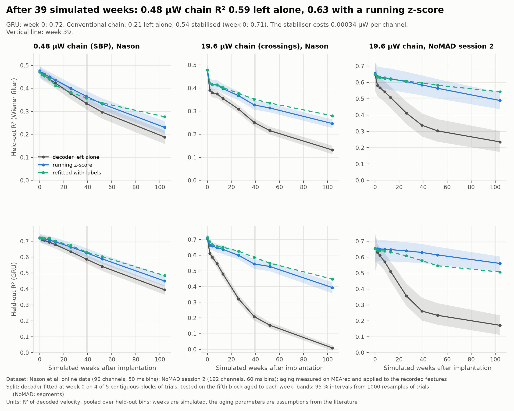
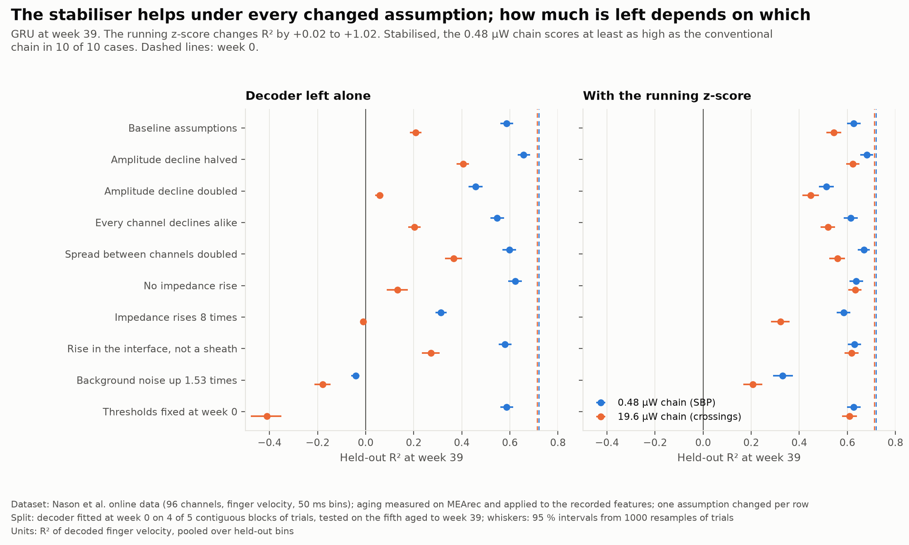
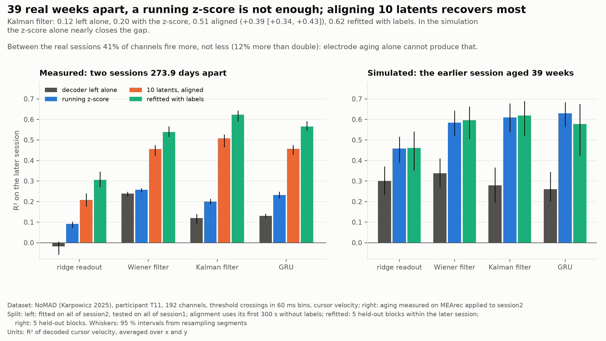
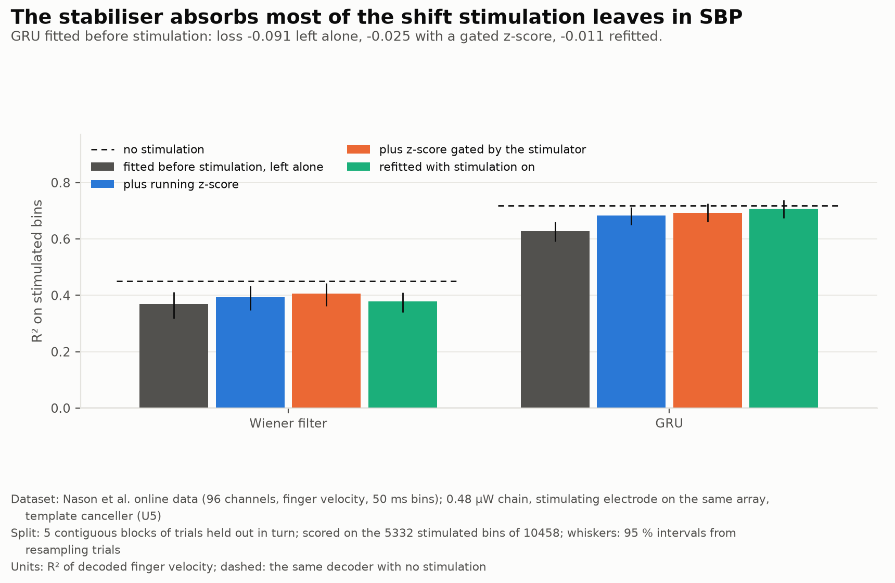

# U6 design: electrode aging stress test

U3 chose a 0.48 µW sensing chain on recordings made with fresh-looking
signals, and U5 showed it keeps decoding while the implant stimulates. An
implant has to work for years, and the electrode it listens through does not
stay the same. U6 asks what happens to decoding as the electrode ages, for
U3's chain and for the conventional one, and what a cheap stabiliser buys.
It is a stress test: a thin module, not a third research spine.

Code: `src/neurochain/aging.py` (the aging model),
`src/neurochain/stabilise.py` (the running stabiliser),
`src/neurochain/align.py` (the latent alignment), `age_sbp` in
`src/neurochain/bridge.py`, `src/neurochain/analysis/u6.py` (the experiment).
One command: `make u6` (about three and a half minutes). Numbers:
`results/u6_metrics.json`.

## 1. What U6 has to answer

1. What does an aging electrode do to the two features, crossings and SBP?
2. How fast does decoding fall if the decoder is left alone?
3. How much of that does the simplest causal stabiliser give back, and what
   does it cost in the µW terms of U3?
4. Does the simulation look like the one real long gap available: NoMAD's two
   sessions, 273.9 days apart?
5. Does the same stabiliser absorb the feature shift U5 found when
   stimulation is switched on?

Done-criterion (from `TODO.md`): R² against simulated weeks.

## 2. Decision 1: where the aging is applied

**The problem.** Aging acts on voltages at the electrode. NoMAD has no
voltages: only threshold crossings counted in 20 ms bins, no waveforms, no
impedance. The Nason decoding file is the same kind of thing with SBP added.
The only data with waveforms *and* ground truth is MEArec, and it has no
behaviour.

**Alternatives.**

- *Model crossing counts directly*, for example "counts fall by x % per
  month". Simple, but x would be invented. How many crossings a 12 % smaller
  spike loses depends on how far above threshold it was, and on the noise.
- *Age the waveforms, then carry the effect across* (chosen). This is U3's
  bridge idea: measure on MEArec what a change does to each feature, express
  it in unit-free quantities, apply those to the recorded features.

**What is measured on MEArec** (`u6._response_job`). For every channel, every
electrode state and eleven spike amplitudes from 1.0 down to 0.0 of week 0:
run the aged electrode through U1's front-end emulator, detect crossings, and
count how many of the week-0 chain's detections of real spikes survive
(`p_keep`) and how many false ones appear (`extra_rate_hz`). Two details:

- *Superposition* (ELEC2133). The front end is linear below its rails, so
  spikes and background are passed through it separately and added afterwards
  at each amplitude. Eleven amplitudes cost two filter runs, not eleven.
- *The implant does not know its electrode changed.* Outputs are referred to
  the input with the fresh chain's gain, so the 0.7 % (crossings chain) and
  2.8 % (SBP chain) loss of gain into the higher source impedance stays in the
  feature, as it would in the implant.

**Carrying it to recorded features** (`u6.make_ager`). Each dataset channel
gets its own amplitude decay rate from the aging model and the measured
response table of one MEArec channel, drawn at random. Then:

- *Crossings* are thinned with that channel's `p_keep` and given its false
  positives (`bridge.degrade_crossings`, now one probability per channel).
  Thinning is a binomial draw per bin (MATH2099).
- *SBP* goes through the new `bridge.age_sbp`. Mean-square values of
  independent signals add, so `sbp² = floor² + spikes²`. Shrinking the spikes
  by `a` multiplies the part above the floor by `a²`; the electrode's extra
  noise is added as in U3; the gain loss multiplies the result.

**A correction the MEArec check forced.** Most of a bin's scatter around the
floor is not spikes. It is the noise itself, averaged over about 70
independent samples, with standard deviation `floor·sqrt((π/2 − 1)/70)`
(MATH2099: the variance of a mean). Shrinking "the part above the floor"
shrinks that scatter too, although the noise has not changed, so the first
version of `age_sbp` kept SBP's signal-to-noise ratio as the spikes shrank,
and the direct simulation showed it does not. The fix puts the missing
variance, a share `1 − a⁴` of it, back
(`tests/test_bridge.py::test_aging_sbp_shrinks_the_signal_but_not_the_noise`).
With it, bridged and directly simulated features agree:

| Spike amplitude | SBP, simulated | SBP, bridged | Crossings, simulated | Crossings, bridged |
|---|---|---|---|---|
| 1.0 (electrode only) | 0.304 | 0.311 | 0.316 | 0.294 |
| 0.8 | 0.232 | 0.224 | 0.244 | 0.232 |
| 0.5 | 0.114 | 0.113 | 0.120 | 0.116 |

Each entry is the correlation of the 50 ms feature with the true spike count,
averaged over 32 MEArec channels, with the settled electrode. The bridge is
within 0.022 everywhere and slightly pessimistic for crossings, as in U3.

**One real channel.** The Nason in-vivo recording (10 s, 30 kHz) cannot have
its spikes shrunk separately from its background, but it can be passed through
the fresh and the settled electrode. Spike-band noise rises from 12.9 to
14.8 µV, the crossing rate falls from 76.9 to 66.5 per second, and SBP barely
moves (16.08 to 16.06 µV). MEArec says the same about the electrode alone:
79 % of crossings kept.

## 3. Decision 2: the aging model and its parameters

`neurochain.aging.AgingModel`. Every number is an assumption taken from one
paper about one kind of array.

| What | Value | Source | Where it enters |
|---|---|---|---|
| Impedance at 1 kHz | × 2.48, 95 % of it within 2 weeks, then flat | Barrese et al. (2013): 305 to 755 kΩ on Utah arrays in monkeys | a series resistance added to the Randles electrode of U1 |
| Electrode noise | follows from the above | Nyquist: `4kT·Re{Z}` (ELEC2133) | U1's front-end noise model |
| Spike amplitude | −2.4 % per month on average | Chestek et al. (2011), as quoted by Barrese et al. | scales the spikes |
| Spread between channels | decay rates gamma distributed, coefficient of variation 1 | assumed | each channel gets its own rate |
| Neural background | unchanged | assumed | 13 µV throughout |

**Where to put the impedance rise.** Three options:

- *Use Straka's implanted-electrode fit* (already in `electrode.py`). It was
  measured in rat sciatic nerve and has a *lower* 1 kHz impedance than the
  saline fit, the opposite of what Utah arrays do in cortex. Rejected.
- *Scale every element* ("interface"): as if the exposed metal had shrunk.
  Keeps the phase; only part of the rise is resistive.
- *Add a series resistance* ("series", chosen). Encapsulation is tissue grown
  around the shank: a resistive sheath between the metal and the neurons. It
  is also the worst case for noise, because all of the added impedance is
  real. `Rs` goes from 7.3 to 418 kΩ so that `|Z|` at 1 kHz goes from 218 to
  540 kΩ.

The alternative is kept as a variation (section 7.3).

**Amplitude decline.** Each channel decays exponentially, `a(t) = exp(−r·t)`,
with its own rate `r`. Rates are gamma distributed around the mean that gives
2.4 % per month. A random walk would let channels grow as well as shrink; that
was rejected because the bridge cannot add spikes a recording never had. What
the model therefore cannot do is discussed with the real session pair in
section 7.4.

**What the model does to the chain** (week 0 to settled):

- conventional chain's front-end noise, 300 Hz to 7.5 kHz, referred to the
  tissue signal: 3.4 to 7.9 µV (electrode 2.5 to 7.5 µV, amplifier 2.3 µV
  unchanged);
- SBP chain's noise power relative to the recording: 1.243 to 1.288;
- spike amplitude at week 39: median 0.87 of week 0 (10th to 90th percentile
  0.55 to 0.98); at week 104: median 0.69 (0.20 to 0.95).

## 4. Decision 3: the stabiliser

### 4.1 Running z-score (`neurochain.stabilise`)

A decoder standardises each feature with two constants stored when it was
fitted: a mean and a scale. Aging makes them stale. The stabiliser replaces
them with running estimates, per channel and per bin:

```
mean <- mean + (x − mean) / 2^shift
mad  <- mad  + (|x − mean| − mad) / 2^shift
z     = (x − mean) / (stored scale · mad / stored mad)
```

- **It is a first-order IIR low-pass** (ELEC3104): `y[n] = (1−α)·y[n−1] +
  α·x[n]` with `α = 2^−shift`. At `shift = 10` and 50 ms bins the time
  constant is 1024 bins, 51 s, a corner near 0.003 Hz. Subtracting it is a
  high-pass on the feature: slow drift goes, movement-related modulation
  (0.1 Hz and up) stays.
- **No multiplier** (ELEC2141). Dividing by a power of two is a wire shift.
  The scale is a mean absolute deviation, which needs neither a square nor a
  square root.
- **Causal.** A bin is normalised with the registers as they were before it
  arrived.
- **The decoder is not refitted.** The registers start from the constants
  the decoder was fitted with, so with nothing changed it behaves as before.
- **Limited gain.** A channel whose spread has shrunk is amplified at most
  4 times. Without the limit a nearly silent channel would be blown up to full
  size, noise and all.
- **Cold start.** At a simulated week the registers start from the week-0
  constants, as if the implant had been switched off since. This matches the
  real NoMAD pair and is pessimistic for an implant in daily use (prediction
  check 3).

**Alternatives.**

- *Re-thresholding.* Recalibrating each channel's threshold to 4.5 times the
  current noise is what U2's detector already does at the start of a
  recording, so it is part of the baseline chain here, not the stabiliser.
  Keeping week-0 thresholds forever is a variation (section 7.3).
- *Running mean only* (three add steps instead of 17). Scored alongside; it
  fixes levels but not lost modulation.
- *The session's own mean and spread* ("batch"). Not causal; scored on the
  real pair as the most any per-channel rescaling could do.
- *Refitting with labels.* What the stabiliser tries to avoid; scored as the
  ceiling.

### 4.2 Latent alignment (`neurochain.align`)

Planned as optional. It turned out to be the part that matters on the real
pair (section 7.4), so it is in.

Motor-cortex activity moves in far fewer dimensions than there are
electrodes. Fit the decoder on a few latent variables instead of on channels,
and on a later day find the same variables again:

1. **Principal axes** (MATH2099). The directions of largest variance of the
   standardised features are the leading right singular vectors of the data
   matrix. Keep ten.
2. **Orthogonal Procrustes** (MATH2099). The later day's axes span nearly the
   same space in a different basis. The rotation that best maps them onto the
   earlier day's, over all orthogonal matrices, is `U·Vᵀ` from the singular
   value decomposition `A_newᵀ·A_ref = U·S·Vᵀ`.

The later day's axes come from its first 300 s of features, without labels,
behind the running z-score. This is the linear idea of Degenhart et al.
(2020). Karpowicz et al. (2025), whose data this is, align nonlinear dynamics
with a recurrent network instead; that was too heavy for a thin module.

Ten dimensions is customary for motor cortex and an assumption here. The
result is sensitive to it (prediction check 2).

### 4.3 Cost

In the terms of `neurochain.power`, every add, subtract or division step
charged as a full 1 pJ multiply (an upper bound, as for U5's canceller):

- running z-score: 17 steps per 50 ms bin, **0.00034 µW per channel**, 0.07 %
  of the 0.48 µW chain; 44 register bits per channel;
- running mean only: 3 steps, 0.00006 µW;
- latent projection: 10 real multiplies per channel per bin, 0.0002 µW. The
  singular value decomposition that finds the axes, once per session, is
  assumed to run outside the implant and is not charged.

## 5. Decision 4: the stimulation shift

U5 found that a decoder fitted before stimulation is switched on loses R²
once it is on, even with the canceller. U6 reruns exactly that case (0.48 µW
chain, stimulating electrode on the recording array, template canceller,
scores on stimulated bins) with the stabiliser in front of the unchanged
decoder. One addition: the stimulator knows when it is on, so the stabiliser
can keep two sets of registers and switch between them with that flag
("gated"). A single set cannot follow trains that last about a second with a
51 s time constant.

## 6. How the scores are made

U4's conventions throughout: the four decoders of `neurochain.decode`, five
contiguous folds of trials, R² pooled over held-out bins, 95 % intervals from
1000 resamples of trials (segments on NoMAD), paired differences, explicit
seeds.

- **Fitted at week 0, tested aged.** Each fold's decoder is fitted on the
  other four folds at week 0 and predicts its held-out fold aged to each week
  (the `fit_folds` / `predict_folds` pattern of U5). Week 0 is therefore
  exactly U4's number for the same chain.
- **Three treatments of the same decoder:** left alone, behind the running
  mean, behind the running z-score. A fourth line refits the decoder on the
  aged features.
- **Paired differences:** `loss` against the same decoder at week 0, `gain`
  against the decoder left alone at the same week.
- **Same random draws at every week,** so a curve shows aging and not the
  bridge's sampling noise.
- **SBP chain on Nason only.** NoMAD has no SBP, so on NoMAD only the
  conventional chain can be aged.

## 7. What the numbers say

### 7.1 The electrode alone costs crossings a fifth, and SBP almost nothing

With spikes unchanged, the settled electrode keeps 79 % of crossings: its
thermal noise raises the threshold. SBP's noise power goes up by 3.6 %
(1.243 to 1.288). The SBP chain listens in 300 Hz to 1 kHz, where the neural
background is strongest and a white noise source contributes least.

Crossings are also the more sensitive feature to amplitude. On the fresh
electrode a spike 10 % smaller keeps 86 % of its crossings, one 20 % smaller
about 72 %, a halved one 32 %. At week 39 the median dataset channel keeps 62 % of
its crossings (10th percentile: 19 %).

### 7.2 R² against simulated weeks (the done-criterion)



Each cell: left alone / running z-score / refitted.

| Chain, dataset, decoder | Week 0 | Week 39 | Week 104 |
|---|---|---|---|
| 0.48 µW (SBP), Nason, GRU | 0.720 | 0.587 / 0.627 / 0.631 | 0.395 / 0.450 / 0.484 |
| 0.48 µW (SBP), Nason, Wiener | 0.472 | 0.335 / 0.365 / 0.358 | 0.188 / 0.230 / 0.277 |
| 0.48 µW (SBP), Nason, Kalman | 0.342 | 0.290 / 0.294 / 0.262 | 0.214 / 0.214 / 0.179 |
| 0.48 µW (SBP), Nason, ridge | 0.438 | 0.323 / 0.340 / 0.352 | 0.193 / 0.215 / 0.271 |
| 19.6 µW (crossings), Nason, GRU | 0.713 | 0.208 / 0.544 / 0.587 | 0.009 / 0.394 / 0.448 |
| 19.6 µW (crossings), Nason, Wiener | 0.478 | 0.251 / 0.327 / 0.351 | 0.132 / 0.246 / 0.280 |
| 19.6 µW (crossings), Nason, Kalman | 0.363 | 0.266 / 0.266 / 0.245 | 0.182 / 0.215 / 0.202 |
| 19.6 µW (crossings), Nason, ridge | 0.471 | 0.125 / 0.285 / 0.344 | −0.196 / 0.189 / 0.270 |
| 19.6 µW (crossings), NoMAD session 2, GRU | 0.655 | 0.261 / 0.630 / 0.578 | 0.172 / 0.561 / 0.507 |
| 19.6 µW (crossings), NoMAD session 2, Wiener | 0.650 | 0.338 / 0.584 / 0.596 | 0.236 / 0.489 / 0.542 |
| 19.6 µW (crossings), NoMAD session 2, Kalman | 0.653 | 0.279 / 0.609 / 0.619 | 0.236 / 0.521 / 0.561 |
| 19.6 µW (crossings), NoMAD session 2, ridge | 0.538 | 0.300 / 0.459 / 0.461 | 0.243 / 0.365 / 0.397 |

Reading it:

- **The key number.** After 39 simulated weeks the 0.48 µW chain with a GRU
  left alone decodes at R² 0.587, down 0.133 [0.112, 0.154] from 0.720. The
  running z-score brings it to 0.627 (+0.040 [+0.028, +0.053]); refitting
  with labels gives 0.631. The stabiliser recovers what refitting would.
- **The conventional chain falls much further when left alone:** 0.713 to
  0.208 with the GRU. The z-score brings it back to 0.544
  (+0.336 [+0.309, +0.364]); refitting gives 0.587. Thinned crossings move
  every channel's level, which a decoder reads as behaviour. SBP sits on a
  noise floor that aging barely moves, so its decoder degrades gracefully.
- **Stabilised, the cheap chain is not the more fragile one.** At week 39 the
  GRU scores 0.627 on the 0.48 µW chain and 0.544 on the 19.6 µW chain; at
  week 104, 0.450 and 0.394. The two started level (0.720 and 0.713).
- **What the stabiliser cannot give back is information.** Refitted decoders
  also fall: 0.631 and 0.587 at week 39, 0.484 and 0.448 at week 104. That
  part is signal-to-noise ratio lost at the electrode, and no processing after
  the amplifier returns it.
- **Scale matters, not just level.** The running mean alone leaves the GRU at
  0.603 on SBP and 0.419 on crossings at week 39, against 0.627 and 0.544 with
  the running scale.
- **The first two weeks are the electrode.** Encapsulation alone takes the
  conventional GRU from 0.713 to 0.612 by week 2 (0.686 refitted), and the
  cheap chain from 0.720 to 0.711.
- **Weak spots, reported as found.** The Kalman filter gains nothing from the
  stabiliser on Nason (0.290 to 0.294 on SBP, 0.266 to 0.266 on crossings) and
  is *worse* refitted (0.262 and 0.245): its fitted noise model does not take
  noisier features well. On NoMAD the refitted GRU (0.578) is below the
  stabilised one (0.630); with 16 segments the interval on that refit is
  [0.423, 0.676], so the order is not established.

### 7.3 The same under changed assumptions



GRU on Nason at week 39; left alone / running z-score.

| Assumption changed | 0.48 µW chain | 19.6 µW chain |
|---|---|---|
| none (baseline) | 0.587 / 0.627 | 0.208 / 0.544 |
| amplitude decline halved | 0.657 / 0.681 | 0.406 / 0.623 |
| amplitude decline doubled | 0.458 / 0.513 | 0.058 / 0.448 |
| every channel declines alike | 0.546 / 0.614 | 0.204 / 0.519 |
| spread between channels doubled | 0.599 / 0.669 | 0.366 / 0.559 |
| no impedance rise | 0.622 / 0.637 | 0.132 / 0.633 |
| impedance rises 8 times | 0.314 / 0.584 | −0.010 / 0.321 |
| rise in the interface, not a sheath | 0.580 / 0.630 | 0.272 / 0.618 |
| background noise up 1.53 times | −0.041 / 0.331 | −0.178 / 0.208 |
| thresholds fixed at week 0 | 0.587 / 0.627 | −0.411 / 0.609 |

What survives:

- The stabiliser helps in all 20 cases, by +0.02 to +1.02.
- Stabilised, the 0.48 µW chain scores at least as high as the conventional
  chain in 10 of 10 cases. With no impedance rise the two are level (0.637
  and 0.633): the cheap chain's edge comes from the electrode's noise, which
  costs crossings more.
- Leaving the decoder alone costs the conventional chain more in every case.

What does not survive: any particular number. The rate of amplitude decline
moves the week-39 score of the cheap chain between 0.513 and 0.681. A
background that rises 1.53 times (the rise in recorded noise Barrese et al.
saw in the first month) is the worst case by far: 0.331 stabilised. A decoder
left alone on a fixed threshold goes to −0.411, because the electrode's noise
alone then adds 2.85 false crossings per second per channel.

A fixed GRU's score under shift is also erratic: 0.132 with no impedance rise
against 0.208 with it. Scores of a decoder outside the conditions it was
fitted in should be read as "broken" or "not broken", not ranked.

### 7.4 The real pair: per-channel statistics are not what changed



Fitted on NoMAD session 2, tested on session 1, 273.9 days (39.1 weeks) later:

| Decoder | Left alone | Running z-score | Session's own z-score | 10 latents, not aligned | 10 latents, aligned | Refitted with labels |
|---|---|---|---|---|---|---|
| Wiener | 0.239 | 0.257 | 0.256 | 0.327 | 0.456 | 0.539 |
| Kalman | 0.119 | 0.200 | 0.188 | 0.367 | 0.508 | 0.623 |
| GRU | 0.131 | 0.233 | 0.214 | 0.382 | 0.457 | 0.565 |
| ridge | −0.018 | 0.092 | 0.088 | 0.158 | 0.208 | 0.305 |

- **The running z-score recovers little:** +0.018 [+0.009, +0.027] for the
  Wiener filter, +0.102 [+0.085, +0.119] for the GRU. It is not the cold start
  or the time constant: the session's own mean and spread, known only
  afterwards, do no better (0.256, 0.214).
- **In the simulation at the same gap it recovers nearly everything**
  (Wiener, session 2 aged 39 weeks: 0.338 left alone, 0.584 stabilised, 0.596
  refitted). So the aging model is not what separates the real sessions.
- **The data says why.** Between the sessions the median channel's rate
  changed by a factor of 0.85, but 41 % of channels fire *more* (12 % more
  than double), 21 % fire less than half, and log rates correlate at only
  0.67. An electrode that only loses spikes cannot produce that. Channels are
  picking up different neurons.
- **Aligning ten latent variables recovers about three quarters of the gap:**
  Wiener 0.239 to 0.456 (+0.216 [+0.187, +0.241]) of 0.539; Kalman 0.119 to
  0.508 (+0.388 [+0.339, +0.426]) of 0.623; GRU 0.131 to 0.457 (+0.326
  [+0.295, +0.344]) of 0.565. Reading ten latents without aligning them
  already helps (0.327, 0.367, 0.382); the rotation adds the rest.
- **This answers U4's open item.** A fixed decoder fails across the sessions
  because the map from neurons to channels changed, not because channel gains
  drifted. The population's low-dimensional structure survived, and can be
  found again without labels from five minutes of data.

Two cautions. The alignment is scored on all bins of the later session,
including the 300 s (24 % of its bins) its axes were estimated from; no labels
were used, but those bins are not strictly out of sample. And ten dimensions
was also the best of the sizes tried on this pair (prediction check 2), so
0.456 is on the optimistic side.

### 7.5 Stimulation: the stabiliser absorbs most of the shift



Change in R² on stimulated bins against the same decoder without stimulation
(0.48 µW chain, same-array stimulation, template canceller):

| Decoder | Left alone (U5) | Running z-score | Gated z-score | Refitted (U5) |
|---|---|---|---|---|
| GRU | −0.091 | −0.035 | −0.025 [−0.042, −0.010] | −0.011 [−0.032, +0.009] |
| Wiener | −0.082 | −0.057 | −0.045 [−0.059, −0.032] | −0.072 [−0.091, −0.052] |

The left-alone and refitted columns reproduce U5's committed numbers exactly,
which checks the protocol. For the GRU the gated z-score removes 0.066
[0.047, 0.086] of the 0.091 loss; refitting removes a little more. For the
Wiener filter the stabiliser beats refitting. So U5's "decoders must be
calibrated with stimulation on" softens to: either refit, or put a gated
running z-score in front.

## 8. Limitations

- **The aging parameters are borrowed.** One paper each, monkey Utah arrays,
  applied to a simulated recording and to a human dataset. The 2.4 % per month
  was read from Barrese et al.'s summary of Chestek et al., not from the
  original.
- **The model only takes away.** Channels lose amplitude monotonically and
  never gain neurons. Section 7.4 shows the real pair is dominated by exactly
  what this leaves out. "R² against simulated weeks" is therefore a statement
  about electrode degradation alone, and optimistic about a fixed decoder plus
  z-score in real use.
- **Later impedance decline is not modelled.** After about 150 days Barrese
  et al. saw impedance fall slowly, usually read as insulation damage, which
  shunts signal. Here impedance stays at its plateau.
- **Every channel shares one impedance trajectory.** Only amplitudes differ
  between channels.
- **The bridge thins crossings at random.** Really the smallest units vanish
  first, and a channel's tuning changes with which units remain. The MEArec
  check covers spike counts, not tuning, because MEArec has no behaviour.
- **MEArec's units are small** relative to the threshold, which makes
  crossings fragile to amplitude loss. A channel dominated by one large unit
  would lose fewer.
- **The SBP chain could not be tested on NoMAD,** real pair included: no SBP
  there.
- **The Nason session is 523 s long.** A 51 s time constant started cold
  spends a visible part of it settling.
- **The decoder was not refitted behind the stabiliser.** Fitting it on
  running-normalised features might do slightly better.
- **One real pair, one participant.** The alignment result has no second pair
  to confirm it, and its dimension was not chosen blind.
- **The stabiliser is floating point.** U5's canceller has a bit-exact integer
  version; this does not. Its structure (shifts, adds, one division) was
  chosen so that U7 could build it.

## 9. Prediction checks

Each changes one setting, reruns the analysis at weeks 0, 39 and 104 without
refits, and prints the new numbers under the committed ones. Each takes about
two minutes. Run them one at a time: each loads the 0.9 GB recording and
starts eight workers. Write down your prediction before opening the answer.

For reference, the committed numbers with the running z-score: Nason, 0.48 µW
chain, GRU: 0.721 at week 0 and 0.627 at week 39; Wiener: 0.476 and 0.365.
Real pair, Wiener: 0.257 with the z-score, 0.456 aligned. Section 7.2 has the
rest.

### Check 1: a stabiliser that forgets faster, or slower

```
make u6-key ARGS="--shift 6"
make u6-key ARGS="--shift 14"
```

The time constant goes from 1024 bins (51 s on Nason, 61 s on NoMAD) to 64
bins (about 3 s) or to 16 384 bins (about 14 minutes). What happens at week 0,
where nothing has changed, and at week 39? Is the answer the same on both
datasets?

<details>
<summary>Answer</summary>

**Slower (`shift 14`) is worse everywhere.** Started cold, the registers never
settle inside a session. Stabilised GRU at week 39: **0.600** on the 0.48 µW
chain (from 0.627), **0.348** on the conventional chain on Nason (from 0.544),
**0.500** on NoMAD (from 0.630). On the real pair the alignment collapses with
it (Wiener **0.321** from 0.456, GRU **0.233** from 0.457), because the axes
are then estimated from features that are not yet normalised.

**Faster (`shift 6`) depends on the dataset.**

- NoMAD, cursor control: it costs even when nothing has changed. Wiener at
  week 0: **0.597** behind the stabiliser against 0.650 without it (0.656 at
  `shift 10`). Week 39: Wiener **0.532** (from 0.584), GRU **0.594** (from
  0.630). Real pair: z-score alone **0.232** (from 0.257, now below the
  decoder left alone), aligned **0.416** (from 0.456).
- Nason, finger movements: it is slightly *better*. Wiener on SBP at week 0:
  **0.489** (0.476 at `shift 10`, 0.472 without). GRU at week 39: **0.637**
  on the 0.48 µW chain (from 0.627), **0.552** on the conventional chain
  (from 0.544).

Subtracting a running mean is a high-pass filter with corner
`α / (2π·T_bin)`: 0.003 Hz at `shift 10`, 0.05 Hz at `shift 6` (ELEC3104).
Cursor movements on NoMAD have energy down there and the filter removes it.
Nason's finger trials are faster, and its session is only 523 s long, so
settling sooner is worth more than the modulation lost.

`shift 10` was chosen by this reasoning before these runs, as one setting for
both datasets. It is not the best setting for Nason, and it was left as it
is: one value tuned per dataset on the test data would not be a design.
</details>

### Check 2: more, or fewer, latent variables

```
make u6-key ARGS="--latents 20"
make u6-key ARGS="--latents 5"
```

The alignment keeps ten principal axes of 192 channels. Twenty keep more of
the signal. Do they align better?

<details>
<summary>Answer</summary>

No. Aligned R² on the real pair, Wiener / Kalman / GRU:

| Latent variables | Wiener | Kalman | GRU |
|---|---|---|---|
| 5 | 0.378 | 0.348 | 0.396 |
| 10 (committed) | 0.456 | 0.508 | 0.457 |
| 20 | 0.305 | 0.316 | 0.392 |

With 20 the unaligned latents also fall (0.249, 0.278, 0.328 against 0.327,
0.367, 0.382 with 10). The later principal axes carry little variance, so
300 s of data estimates them poorly, and they are the ones least shared
between days. The Procrustes rotation matches them anyway, because it must
return a full rotation. With 5 the alignment is clean but the decoder has
lost directions it needs.

So there is a narrow best size, and on this pair it is ten. That is the
caution of section 7.4: ten was a reasonable prior, it was also the best of
the three, and there is no second pair to check it on.
</details>

### Check 3: an implant that was used yesterday

```
make u6-key ARGS="--warm-start"
```

By default the registers start each simulated week from the week-0 constants,
as if the implant had been off since. With this option they start from the
aged session's own statistics. How much of the gap between the stabiliser and
refitting was the cold start?

<details>
<summary>Answer</summary>

Little. Stabilised GRU, warm against cold:

| | Week 39 | Week 104 |
|---|---|---|
| 0.48 µW chain, Nason | **0.631** against 0.627 | **0.456** against 0.450 |
| 19.6 µW chain, Nason | **0.560** against 0.544 | **0.427** against 0.394 |
| 19.6 µW chain, NoMAD session 2 | **0.623** against 0.630 | **0.547** against 0.561 |

On the 0.48 µW chain the warm start reaches the refitted decoder (0.631). On
the conventional chain it closes 0.016 of the 0.043 between the stabiliser
and refitting at week 39. On NoMAD, where the session is 29 minutes of
recording, the cold start had already cost nothing.

A 51 s time constant settles in a few minutes, so a cold start only matters
when the session is short and the shift large (crossings at week 104). The
warm start here uses the whole session's statistics, which a real implant
would not have; it is an upper bound on "yesterday's values".
</details>

## 10. What to read next

- Barrese et al. (2013), sections on impedance and signal over time: the
  curves this model compresses into two numbers, and the later decline it
  leaves out.
- Degenhart et al. (2020): the alignment idea done properly, with factor
  analysis and a choice of stable channels.
- Karpowicz et al. (2025): why linear alignment is not the end of the story,
  on this same dataset.
- Jarosiewicz et al. (2015): feature statistics tracked during real use.
- In this repo: `tests/test_stabilise.py::test_running_statistics_are_causal`
  and `::test_gated_registers_keep_two_conditions_apart`;
  `tests/test_bridge.py::test_aging_sbp_shrinks_the_signal_but_not_the_noise`.

U7 implements the SBP path and U5's canceller in RTL. The stabiliser's two
registers per channel are a natural third block: 44 bits, no multiplier.

## Papers used

For the housekeeping session to move into `docs/references.md`.

1. Barrese, J. C., Rao, N., Paroo, K., Triebwasser, C., Vargas-Irwin, C.,
   Franquemont, L. and Donoghue, J. P. (2013). Failure mode analysis of
   silicon-based intracortical microelectrode arrays in non-human primates.
   *Journal of Neural Engineering* 10(6), 066014.
   https://doi.org/10.1088/1741-2560/10/6/066014. Use: the impedance rise
   (305 to 755 kΩ, 2.48 times, in two weeks, then stable for about 150 days),
   the 1.53-fold rise in recorded noise used as a variation, and the quoted
   Chestek figure. Read in this session (PMC4868924).
2. Chestek, C. A. et al. (2011). Long-term stability of neural prosthetic
   control signals from silicon cortical arrays in rhesus macaque motor
   cortex. *Journal of Neural Engineering* 8(4), 045005.
   https://doi.org/10.1088/1741-2560/8/4/045005. Use: 2.4 % per month decline
   in spike amplitude. Taken from Barrese et al.'s summary; not checked
   against the original text. Verify before quoting outside this project.
3. Straka, M. M. et al. (2018), already in `docs/references.md`. Use: the
   fresh electrode (Randles with a constant-phase double layer), and the
   reason its implanted fit was not used.
4. Williams, J. C., Hippensteel, J. A., Dilgen, J., Shain, W. and Kipke, D. R.
   (2007). Complex impedance spectroscopy for monitoring tissue responses to
   inserted neural implants. *Journal of Neural Engineering* 4(4), 410–423.
   https://doi.org/10.1088/1741-2560/4/4/007. Use: tissue reaction raises
   1 kHz impedance in the first week; support for modelling encapsulation as
   added tissue impedance. Only a summary was read.
5. Sankar, V., Patrick, E., Dieme, R., Sanchez, J. C., Prasad, A. and
   Nishida, T. (2014). Electrode impedance analysis of chronic tungsten
   microwire neural implants: understanding abiotic vs. biotic contributions.
   *Frontiers in Neuroengineering* 7, 13.
   https://doi.org/10.3389/fneng.2014.00013. Use: impedance rises and later
   falls; the fall is listed as not modelled.
6. Karpowicz, B. M. et al. (2025). Stabilizing brain-computer interfaces
   through alignment of latent dynamics. *Nature Communications* 16, 4662.
   https://doi.org/10.1038/s41467-025-59652-y. Already in
   `docs/references.md`. Use: the NoMAD sessions; the idea of unsupervised
   alignment. Its method (nonlinear, recurrent) is not implemented here.
7. Degenhart, A. D., Bishop, W. E., Oby, E. R., Tyler-Kabara, E. C.,
   Chase, S. M., Batista, A. P. and Yu, B. M. (2020). Stabilization of a
   brain–computer interface via the alignment of low-dimensional spaces of
   neural activity. *Nature Biomedical Engineering* 4(7), 672–685.
   https://doi.org/10.1038/s41551-020-0542-9. Use: the linear precedent for
   `neurochain.align` (fit a low-dimensional space per day, align the spaces).
   This repo uses principal components and a Procrustes rotation, which is
   simpler than their method; the details of theirs were not re-read.
8. Jarosiewicz, B. et al. (2015). Virtual typing by people with tetraplegia
   using a self-calibrating intracortical brain-computer interface. *Science
   Translational Medicine* 7(313), 313ra179.
   https://doi.org/10.1126/scitranslmed.aac7328. Use: precedent for tracking
   feature statistics during use instead of recalibrating.
9. Schönemann, P. H. (1966). A generalized solution of the orthogonal
   Procrustes problem. *Psychometrika* 31(1), 1–10.
   https://doi.org/10.1007/BF02289451. Use: the `U·Vᵀ` solution in
   `align.procrustes_rotation`. Citation from memory; verify the DOI.
10. Nason, S. R. et al. (2020) and Buccino, A. P. and Einevoll, G. T. (2021),
    both already in `docs/references.md`. Use: SBP and the Nason data;
    MEArec.
